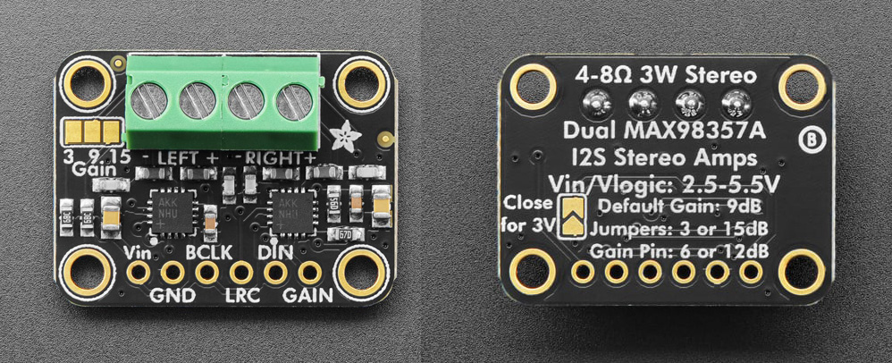
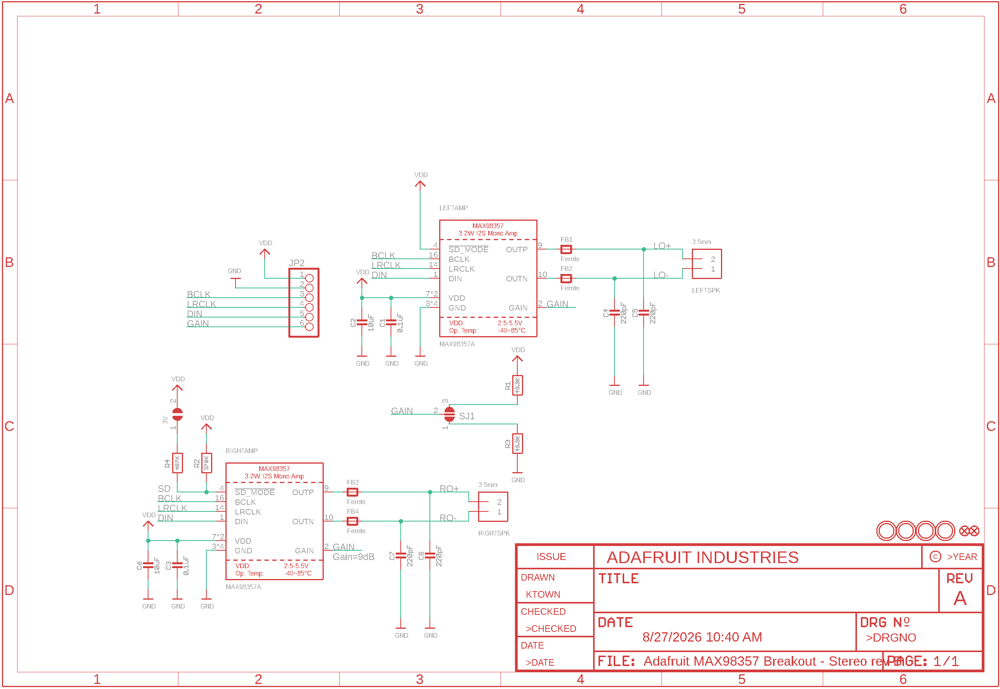

# Propuesta de trabajo práctico: módulo de audio estéreo con MAX98357A

## 1. Descripción general

Se propone una réplica del módulo estéreo de Adafruit basado en el amplificador de clase D I2S MAX98357A, adaptada para integrarse como shield compatible con la placa nRF7002 DK y con conectores tipo Arduino Uno.

La referencia base utiliza dos canales de potencia para parlantes pasivos y recibe audio digital por I2S, manteniendo la funcionalidad original y agregando mejoras orientadas a uso práctico, integración y depuración del sistema.

## 2. Fuente de referencia

- Adafruit MAX98357A I2S Class-D Mono Amp
- Sitio oficial: https://learn.adafruit.com/adafruit-max98357-i2s-class-d-mono-amp

La placa de Adafruit sirve como referencia funcional para la etapa de potencia, la configuración de entrada I2S, el manejo del gain y la disposición de los conectores de salida.

## 3. Objetivo del circuito

El circuito tiene como finalidad generar salida de audio de potencia a partir de una señal digital I2S, permitiendo alimentar parlantes pasivos de 4 y 8 ohm con una calidad de audio adecuada para prototipos, pruebas de audio y sistemas embebidos.

En particular, la propuesta busca:

- Reproducir la funcionalidad de un módulo estéreo de potencia con dos canales independientes.
- Mantener compatibilidad con señales I2S estándar.
- Integrar un diseño compatible con un shield para la placa nRF7002 DK basado en conectores tipo Arduino Uno.
- Permitir una conexión directa y sencilla de parlantes mediante conectores jack de 6.5 mm.
- Facilitar la selección de ganancia según la carga y la aplicación.

## 4. Modificaciones propuestas respecto del módulo original

### 4.1. Indicador LED de alimentación por canal

Se incorporarán indicadores LED por cada amplificador MAX98357A para verificar visualmente la presencia de alimentación en cada etapa de potencia.

Esto mejora la depuración del sistema y facilita la comprobación rápida de que ambas rutas de audio están funcionando correctamente.

### 4.2. Cambio de factor de forma

Se modificará la disposición física del PCB para que sea compatible con un shield para nRF7002 DK, siguiendo una distribución basada en los conectores de Arduino Uno.

Esto implica:

- Ajustar la ubicación de los headers de conexión.
- Mantener una geometría que permita su montaje directo sobre la placa base.
- Respetar la alineación de pines y la separación recomendada para no interferir con otros módulos.

### 4.3. Cambio de borneras por jack 6.5 mm

Se reemplazarán las borneras originales por conectores jack de 6.5 mm para la salida hacia parlantes pasivos de 4 y 8 ohm.

Esta modificación facilita:

- La conexión directa con parlantes de uso común.
- La compatibilidad con cargas típicas de audio de baja impedancia.
- Una interfaz más robusta y sencilla para el usuario final.

### 4.4. Selector de ganancia configurable

Se agregará un switch para seleccionar fácilmente entre distintas ganancias:

- 3 dB
- 9 dB
- 15 dB

Esto permitirá ajustar el nivel de salida según la sensibilidad del parlante y la potencia requerida, sin necesidad de modificar el circuito ni cambiar componentes.

## 5. Imágenes de referencia y placa propuesta

### Vista de la placa de referencia

### Esquema de referencia del módulo MAX98357A

## 6. Notas finales

Este documento se presenta como la propuesta definida para el trabajo práctico, reuniendo la referencia de origen, la funcionalidad esperada y las modificaciones necesarias para convertir el módulo base en una versión adaptada a las condiciones del proyecto.
